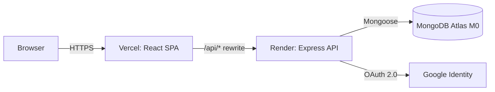
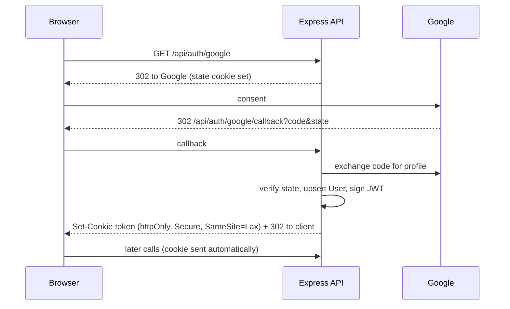

# Architecture — Smart Workspace Scheduler

## 1. Overview
Classic MERN, split into a static React SPA and a stateless Express API backed by MongoDB Atlas.



The browser only ever talks to the Vercel origin; `/api/*` is rewritten to Render. Cookies stay first-party (no third-party cookie issues).

## 2. The 4-step flow (interview version)
1. **React** — user picks a room and time, clicks *Book*.
2. **Express** — `POST /api/bookings` hits the route; auth + Zod validation middleware run.
3. **Node service layer** — `bookingService` checks rules, builds the 30-min slot list, then attempts the insert.
4. **MongoDB** — a unique partial index rejects any overlapping slot atomically; success returns `201`, a collision returns `409`, and React updates the UI.

## 3. Data model (Mongoose)
**User** `{ googleId, name, email (unique), avatar, role: 'user'|'admin', isDemo, createdAt }`

**Resource** `{ name, type: 'room'|'desk', capacity, location, amenities: [String], description, isActive, createdAt }`

**Booking**
```
{
  resource: ObjectId -> Resource,
  user: ObjectId -> User,
  start: Date (UTC), end: Date (UTC),
  slots: [Date],            // every 30-min slot start covered; emptied on cancel
  status: 'confirmed' | 'cancelled',
  createdAt, cancelledAt
}
```

### Indexes
| Collection | Index | Purpose |
|---|---|---|
| Booking | `{ resource: 1, slots: 1 }` **unique**, `partialFilterExpression: { status: 'confirmed' }` | **Atomic double-booking prevention** |
| Booking | `{ resource: 1, start: 1, end: 1 }` | Overlap/availability queries |
| Booking | `{ user: 1, start: -1 }` | "My bookings" |
| Resource | `{ type: 1, isActive: 1 }` | Filtering |
| User | `{ email: 1 }` unique, `{ googleId: 1 }` | Login lookup |

## 4. Conflict prevention (the core)
**Problem:** check-then-save has a race — two requests can both pass the check, then both save.

**Solution:** make the *database* the arbiter.
1. Validate rules (alignment, duration, window) in `bookingService`.
2. Expand `[start, end)` into 30-minute slot starts → `slots`.
3. `Booking.create(...)`. The multikey unique partial index means two *confirmed* bookings can never share `(resource, slot)`.
4. On Mongo error `11000` → run an overlap query to report the conflicting window → respond `409 SLOT_TAKEN`.
5. Cancel sets `status: 'cancelled'` and `slots: []`, so the index entry disappears and the slot is free.

The friendly overlap query (`start < newEnd && end > newStart`) is used for **messages and availability display only**, never as the safety guarantee.

## 5. Authentication flow

- Passport `passport-google-oauth20` with `session: false`; a short-lived signed **state cookie** protects the redirect flow.
- JWT payload: `{ sub: userId, role }`, 7-day expiry. Middleware reads the cookie, falling back to `Authorization: Bearer` (for Postman/API clients).
- Admin role: users whose email is in `ADMIN_EMAILS` get `role: 'admin'` at login.
- CSRF: SameSite=Lax cookie, JSON-only API, CORS whitelist. State-changing endpoints are never GET.

## 6. Backend structure
```
server/
  src/
    app.js                # express app (no listen) — testable
    server.js             # connects DB + listens
    config/               # env.js (validated), db.js, passport.js
    models/               # User, Resource, Booking
    routes/               # auth, resources, bookings, health
    controllers/          # thin: parse -> service -> respond
    services/             # bookingService, resourceService, authService
    middleware/           # auth, requireRole, validate(zod), rateLimit, error
    validators/           # zod schemas
    utils/                # slots.js, time.js, ApiError.js
    seed/seed.js
  tests/                  # unit/, integration/, concurrency/
client/
  src/{api,components,context,hooks,pages,utils}
```

## 7. Frontend structure
React Router pages (`Dashboard`, `ResourceDetail`, `MyBookings`, `Admin`, `Login`), an `AuthContext`, a small `api/` wrapper (fetch + error normalisation), and utilities (`status.js` for badge logic, `time.js` for UTC⇄local).

## 8. Error handling
Single error middleware returning `{ error: { code, message, details? } }`. Known codes: `VALIDATION_ERROR` 400, `UNAUTHENTICATED` 401, `FORBIDDEN` 403, `NOT_FOUND` 404, `SLOT_TAKEN` 409, `INVALID_STATE` 409, `RATE_LIMITED` 429, `INTERNAL` 500.

## 9. Environment variables
| Var | Where | Notes |
|---|---|---|
| `MONGODB_URI` | server | Atlas connection string |
| `JWT_SECRET` | server | 32+ random bytes |
| `GOOGLE_CLIENT_ID` / `GOOGLE_CLIENT_SECRET` | server | From Google Cloud console |
| `GOOGLE_CALLBACK_URL` | server | `https://<vercel-domain>/api/auth/google/callback` in prod |
| `CLIENT_URL` | server | CORS + post-login redirect |
| `ADMIN_EMAILS` | server | Comma-separated |
| `ENABLE_DEMO_ADMIN` | server | `true` only in local/CI |
| `NODE_ENV`, `PORT` | server | |
| `VITE_API_BASE` | client | `/api` (proxy in dev and prod) |

## 10. Security checklist
Helmet · CORS whitelist · rate limits (auth, booking, global) · Zod on every body/query/param · reject `$`-prefixed keys (NoSQL injection) · secrets only in env · httpOnly+Secure cookie · role checks in middleware · no stack traces in production responses.

## 11. Scalability notes (for interviews)
Stateless API ⇒ horizontally scalable; correctness relies on a DB index, not in-process locks, so multiple instances stay safe. Slot granularity (30 min) trades flexibility for a simple, bulletproof invariant.

## 12. Risks
Render cold starts; Atlas M0 connection/storage limits (keep pool small, `maxPoolSize: 10`); Google OAuth consent screen in "testing" mode limits login to listed test users until published — hence the demo login.
